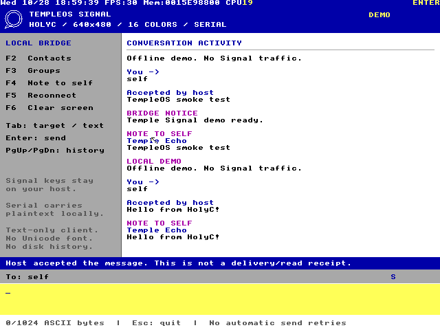

# Temple Signal

**Signal text messaging from a real HolyC program in stock TempleOS.**

640x480. Sixteen colors. Ring 0. Terry's compiler. A serial cable to the outside
world.

Temple Signal is an unofficial text client with a native TempleOS interface and
a local host bridge. The HolyC application handles the screen, keyboard, serial
UART, framing, contact/group selection, and conversation display. A separately
installed **signal-cli** on the host handles the actual Signal account, network
connection, and cryptography.

TempleOS deliberately has no networking. Preserving that constraint means this
project is a **HolyC terminal for a host-side Signal endpoint**, not a standalone
HolyC rewrite of libsignal. The guest has no IP stack or virtual network card.
The local serial link carries plaintext, so the host and VM form one trusted
endpoint. Signal's end-to-end encryption ends at signal-cli on that host.



## What works in version 0.1

| Capability | Implementation |
| --- | --- |
| Native interface | HolyC, original 640x480 VGA palette, keyboard controls |
| Direct text messages | E.164 phone numbers or Signal account UUIDs |
| Note to Self | Send and receive through the linked host account |
| Existing groups | List joined groups, select one, send and receive text |
| Contacts | Paginated contact picker |
| Incoming events | Poll and acknowledge; retain the current event until acknowledged |
| Serial transport | Polled 16550 COM1, bounded UTF-8/hex frames, CRC-16 checks |
| Send status | Explicit host acceptance, errors, and uncertain outcomes; no automatic retries |
| Offline demonstration | Local echo backend, prominently labeled DEMO |
| Application media | Reproducible native RedSea CD or ATA image |
| Verification | Python tests plus a real TempleOS/QEMU smoke harness |

The guest composes printable ASCII. Incoming Unicode travels through the bridge
correctly, but characters outside TempleOS's bitmap font display as `?`. The
screen is a shared activity view with a bounded, memory-only transcript. It is
not a full replacement for Signal Desktop.

## Start here

A [prebuilt application disc](releases/v0.1.0/TEMPLEOS_SIGNAL.ISO) and its
[SHA-256 checksum](releases/v0.1.0/SHA256SUMS) are included. It is a 114 KiB
source disc for TempleOS, used alongside the original OS boot ISO and the host
bridge. You can also reproduce it with the build command below.

You need Python 3.11+, QEMU with its graphical display backend, and the original
[TempleOS ISO](https://templeos.org/Downloads/TempleOS.ISO). The bridge and media
builder use only Python's standard library.

```sh
git clone https://github.com/NoahWLono/TEMPLEOSSIGNAL.git
cd TEMPLEOSSIGNAL
python3 scripts/build_media.py
python3 -m temple_signal --demo --socket /tmp/temple-signal-run/serial.sock
```

In another terminal, from the same repository:

```sh
python3 scripts/run_qemu.py \
  --templeos-iso /path/to/TempleOS.ISO \
  --socket /tmp/temple-signal-run/serial.sock
```

The bridge creates a private socket directory if it does not exist. If that
path belongs to a different user or an existing process, choose a new private
path in both commands. The launcher disables guest networking.

Inside TempleOS, decline installation and the tour. Mount the second CD and
load the application:

```c
CBlkDev *appcd=BlkDevNextFreeSlot('U',BDT_ATAPI);
appcd->base0=0x170;
appcd->base1=0;
appcd->unit=1;
BlkDevAdd(appcd,,FALSE,TRUE);
Cd("U:/Signal");
#include "Load.HC"
```

These IDE addresses match the supplied launcher. Use an existing `U:` mount
instead if it is already present.

For real Signal, install and link a current
[signal-cli](https://github.com/AsamK/signal-cli), stop the demo bridge, and run:

```sh
python3 -m temple_signal \
  --account +15551234567 \
  --socket /tmp/temple-signal-run/serial.sock
```

Replace the example number with your linked account. A Signal ACI UUID is also
accepted. Account linking, QR scanning, identity verification, and troubleshooting
are covered in the **[complete setup guide](docs/SETUP.md)**. The bridge never
registers an account or silently trusts a new identity for you.

## Keyboard controls

| Key | Action |
| --- | --- |
| F2 | Browse contacts |
| F3 | Browse existing groups |
| F4 | Select Note to Self |
| F5 | Reconnect / new handshake |
| F6 | Clear the visible transcript |
| Tab | Switch recipient and composer focus |
| Enter | Send, or choose the selected directory entry |
| Ctrl+U | Clear the focused input |
| Page Up / Page Down | Scroll activity, or change directory page |
| Escape | Close directory, then exit application |

## Test it

Host tests include an actual fake JSON-RPC subprocess and private Unix-socket
integration. They never send a message to Signal:

```sh
python3 -m unittest discover -s tests -v
python3 -m unittest discover -s scripts/tests -v
```

To compile and run the native HolyC tests inside the original TempleOS:

```sh
python3 scripts/smoke_qemu.py --templeos-iso /path/to/TempleOS.ISO
```

The native harness builds the application disc, boots QEMU, enters the HolyC
commands, exchanges messages with the offline bridge, and requires the native test markers. By default it also types a message through
the actual UI, verifies a receive event, and captures the VGA screen:

```text
TS SELFTEST PASS
TS SERIAL PASS
TS SMOKE PASS
TS UI PASS
```

See **[verification details](docs/TESTING.md)** for tested versions, evidence,
and the separate live-account acceptance procedure. A passing demo is evidence
of the guest/host path; real Signal service interoperability also depends on your
linked account and installed signal-cli version.

## Scope and trust

Version 0.1 handles plain text, contacts, and existing groups. It does not provide
voice/video calls, attachments, stickers, reactions, group administration,
username lookup, full Unicode input, or durable history. Disappearing and
view-once content is withheld, and sends to known timed chats are rejected.
Edits and remote deletions become notices; they cannot retract text that the
guest has already displayed. Clear it with F6 or close the VM.

The host owns Signal's keys and can read messages. Anyone controlling the VM,
host account, or local serial path controls this endpoint. TempleOS has no
process isolation. CRC detects serial corruption; it is not authentication or
encryption. No custom cryptographic implementation is presented as Signal.
The bridge itself does not write a message log, but signal-cli manages its own
account state and upstream storage. See the
[architecture and trust model](docs/ARCHITECTURE.md).

## Source map

| Path | Purpose |
| --- | --- |
| `TempleOS/Load.HC` | Native application entry point |
| `TempleOS/Serial.HC` | Polled COM1 UART driver |
| `TempleOS/Protocol.HC` | Frame codec, CRC, UTF-8 validation, bounded RPC |
| `TempleOS/Screen.HC` | Fixed-palette display and literal glyph rendering |
| `TempleOS/Client.HC` | Messaging, navigation, and keyboard behavior |
| `TempleOS/Test.HC` | Native compiler and serial integration tests |
| `temple_signal/` | Host bridge, offline demo, and signal-cli adapter |
| `scripts/` | RedSea media builder, QEMU launcher, native smoke harness |
| `PROTOCOL.md` | Exact guest/host wire contract |
| `docs/UPSTREAM.md` | Primary references, pinned revisions, and ISO checksum |

## Attribution and license

The original GPL-3.0 license of this repository is retained. New project code is
GPL-3.0-only. TempleOS is Terry A. Davis's public-domain operating system; its
original design and source are referenced, not claimed as this project's work.
Signal and its logo are trademarks of Signal Technology Foundation. This project
is independent and is not endorsed by Signal. signal-cli is also an independent
project. No Signal server code, proprietary credentials, or upstream binaries
are included in the source tree.
