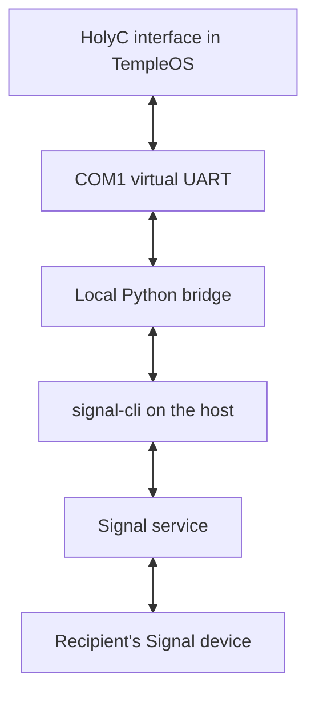

# Architecture and limits

## The message path

Signal's end-to-end encryption starts and ends at signal-cli on the local host
and the remote Signal device. The host bridge and TempleOS guest are part of
your local endpoint. Both handle message plaintext. This project does not move
Signal's keys into HolyC or claim to have ported libsignal.

The guest preserves TempleOS's original graphics, language, execution model and
lack of a network stack. Serial I/O is the only added communication path. The
host has a modern operating system and an ordinary Internet connection.

## Responsibilities

| Component | Responsibilities |
| --- | --- |
| HolyC client | COM1 I/O, bounded serial decoding, text entry, contact and group selection, message rendering, polling, user-visible errors |
| Python bridge | Serial framing, command validation, request correlation, duplicate suppression within a session, bounded volatile inbox |
| signal-cli adapter | Private JSON-RPC process, Signal command mapping, receive-event normalization, account selection, conservative unsupported-feature handling |
| signal-cli and libsignal | Signal authentication, identity keys, cryptographic protocol state, encrypted service transport and protocol compatibility |
| RedSea media builder | Deterministic packaging of original HolyC files for TempleOS's actual filesystem driver |

The [wire protocol](../PROTOCOL.md) defines a CRC-protected, bounded ASCII frame
with hex-encoded UTF-8 fields. The CRC detects serial corruption. It is neither
authentication nor encryption. Only one guest request is outstanding at a time.
The host responds to polling instead of sending unsolicited UART bursts.

## Local boundary

The bridge listens on a UNIX-domain socket inside an owner-only directory.
The QEMU launcher connects a virtual serial port to that socket and creates no
guest NIC. The bridge uses private pipes to its signal-cli child. There is no
TCP listener, HTTP control endpoint or shell command received from the guest.

Local operating-system permissions matter here: a process running as the same
user, the host administrator, a hypervisor operator or a TempleOS task has a
position inside this endpoint. TempleOS runs tasks in ring 0 without isolation
between them. This application cannot change that property.

Received text is rendered as glyphs. It is not executed as HolyC, formatted as
DolDoc commands, opened as a URL or used as a printf format string. Outgoing
commands are a fixed allowlist. Filesystem paths and process arguments are
selected on the host, never supplied by chat text.

## Delivery and recovery

A successful `send` response supplies a Signal timestamp. It does not certify
that the recipient received or read the message. A timeout is ambiguous and is
never automatically retried. The serial layer caches completed request replies
within the current session, so a duplicate request ID cannot accidentally cause
a second send. That cache does not survive a bridge restart.

Incoming events remain available until the guest acknowledges their event ID.
The guest deduplicates repeated events. Queues and transcript storage are
bounded. Overflow becomes a visible notice; this is not a durable mailbox.
The bridge does not add plaintext history files or log chat bodies. signal-cli
still has its own account state, storage and process behavior on the host.

## Version 1 scope

The client provides text messages to existing direct recipients, existing
groups, and Note to Self, plus incoming text and contact/group browsing.
Keyboard entry and display use TempleOS's limited character repertoire. UTF-8
can traverse the host protocol, but unsupported glyphs display as `?`.

Registration, linking, CAPTCHA handling, account repair and safety-number
verification happen on the host. Version 1 does not provide voice/video calls,
attachment viewing, stickers, reactions, message editing, group administration,
username lookup, durable history or complete official-client parity.

Disappearing and view-once message content is suppressed. The bridge refuses
outgoing text into conversations whose known expiration settings it cannot
honor. Such cases produce an explicit notice or error rather than a misleading
promise that data will vanish from a TempleOS transcript.

## Demo versus Signal

Demo mode is deterministic, labeled, and has no Signal account or Internet
dependency. It exercises the same guest, serial frame format and command path.
Signal mode swaps in the JSON-RPC adapter. Passing the demo proves that the
HolyC application communicates with the bridge. Actual interoperability with a
particular linked account also depends on a current signal-cli release, service
availability, account status and a user-run send/receive check.
